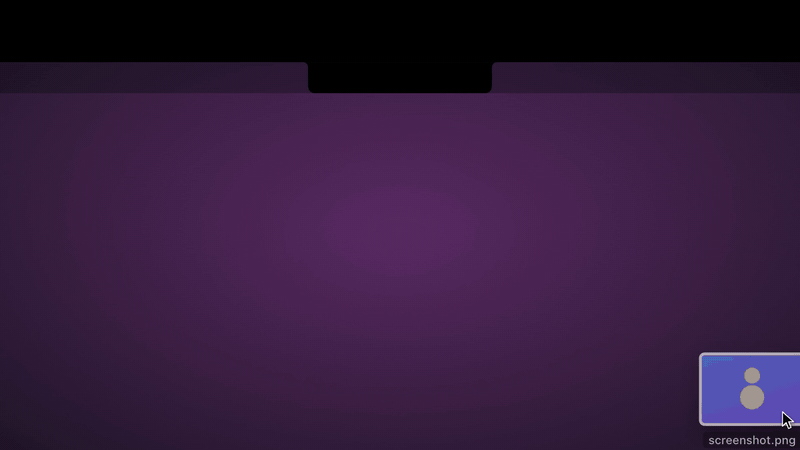

# Blotch

**Your MacBook's notch, put to work.** Black + notch.

<p align="center">
  
</p>

<p align="center">
  <a href="https://aebyra.com/blotch#film"><b>Watch the 74-second video</b></a> · <a href="https://aebyra.com/blotch">aebyra.com/blotch</a> · <a href="#install">Install</a>
</p>

Blotch is a native macOS app that turns the notch into a live status light, a drop zone for quick actions, and a place where your scripts, terminals and coding agents can reach you. It gives you:

1. **A notch anything can talk to.** Scripts, terminals, CI and Shortcuts push live activities with the `blotch` CLI, a Unix socket, or `blotch://` URLs.
2. **A status glow.** A thin outline around the notch with four meanings (Running, Done, Needs you, Failed), each in a color you can set.
3. **Drop actions.** Drag files, text or links onto the notch and drop them on an action: OCR, remove background, compress, make a GIF, merge PDFs, zip, AirDrop, and **Convert to** images, video, audio and document formats (batch). On macOS 26, a few text actions can optionally use Apple's on-device model.
4. **Coding agents.** Connect Claude Code and Codex in Settings → Integrations: the notch pulses in the Running color while the agent works, glows Needs you when it's waiting for you, and Done when it finishes. One entry per session and project.
5. **Screenshots and screen recording.** Area, window or screen, from the notch, or `blotch screenshot` / `blotch record`. While recording, the notch pulses in the Running color with a red **Rec** timer beside it and a Stop button. Afterwards, a screenshot offers Copy, Extract Text and AirDrop; a recording offers Make GIF, Compress and AirDrop.
6. **Privacy monitor.** "Discord is using the microphone" with a Show button, "Camera is on", and a short in-memory history in the notch. The notch also hides itself from screenshots and screen sharing.
7. **Now Playing.** Music and Spotify: track, artwork, progress, play/pause/skip, on hover.
8. **Downloads.** A finished download glows briefly; hover to Open, AirDrop or run an action (Convert to…) on it.
9. **Calendar.** Glows before events with a **Join** button for Zoom/Meet/Teams/Webex/FaceTime; "Up next" in the panel. Off until you turn it on.
10. **Process watcher.** Pick processes to watch (`xcodebuild`, `cargo`, `ffmpeg`, `npm`…). Each gets its own glow color: it pulses while running, then shows "finished" when it exits.
11. **Sneak peek and progress ring.** A few words beside the closed notch, no hover needed: "Rec 0:42", "Build 60%", "Standup in 3m", "Zoom" on the mic. When a task reports progress, the glow fills up around the notch.
12. **Teleprompter.** Your script scrolls in a window under the camera, so you look at the lens while reading. Hidden from screen sharing and recordings. It can **follow your voice** (on-device speech recognition: it moves as you speak and waits when you pause), read the script **from Notes, Word, Pages or TextEdit**, **follow Keynote or PowerPoint** presenter notes slide by slide, or take selected text from **any app** via Services → Read in Blotch Teleprompter. ⌃⌥P, the 📜 button, or `blotch teleprompter script.txt`.
13. **Connection and battery.** A yellow glow when the internet or a VPN drops ("Back online" when it returns) and when the battery runs low (red when very low). No permission needed.
14. **Clipboard tools.** Copy something, then hover: format or minify JSON, clean tracking from a link, Unix time ⇄ date, decode Base64, a JWT or %-encoding, remove formatting.
15. **Coding agents, deeper.** Allow or deny Claude Code's permission requests from the notch (it hands back to the terminal if you don't answer), jump to the exact terminal tab, see how long each session has run, and "+120 −30 · 6 files" when it finishes. `blotch ask` lets any script ask a question with buttons.
16. **Focus timer.** ⏱ in the notch, ⌃⌥T or `blotch timer 25m`: the time left beside the notch, the glow filling, a break offered at the end, today's sessions counted.
17. **Shelf.** Drop files, links or text on **Keep** to park them; drag them out later into any app, AirDrop them all, or run an action on one.
18. **Music bars.** While Music or Spotify plays: album art and bouncing bars beside the notch, tinted with the artwork's color.

```bash
blotch run npm test                 # pulsing blue while running → green ✓ / red ✗ + sound
blotch "Deploy finished" -c done   # quick notification + glow until you hover
eval "$(blotch shell-init zsh)"     # notify whenever any command takes > 10s
open "blotch://glow?glow=red&id=ci&ttl=0"   # from Shortcuts, Raycast, anything
```

| Know when anything finishes | Drop a file to convert or clean it up | Record your screen from the notch |
|---|---|---|
|  |  |  |

## Install

```bash
brew trust aebyra/tap
brew install --cask aebyra/tap/blotch
```

`brew trust` is needed once: Homebrew 7 only loads casks from taps you've trusted.

Or download **Blotch.dmg** from [Releases](https://github.com/aebyra/blotch/releases/latest), open it and drag Blotch to Applications. Blotch updates itself.

The Homebrew install also links the `blotch` command. With the DMG, right-click the notch → **Install Command Line Tool…**.

### Permissions

Blotch asks only when you first use a feature that needs one:

| Permission | Asked when you… |
|---|---|
| Screen Recording | take a screenshot or recording from the notch |
| Microphone | record with "Record microphone audio", or turn on the teleprompter's "Follow my voice" |
| Speech Recognition | turn on "Follow my voice" (recognition runs on your Mac) |
| Calendars | turn on Calendar in Settings → Widgets (read-only) |
| Automation | control Music/Spotify, read a script from Notes/Word/Pages/Keynote, or install the CLI |

### Privacy

Blotch has no analytics, no accounts and no servers of its own. What you copy, record or say stays on your Mac. It goes online only for: the update check (GitHub), Spotify album art for the playing track, a web page you drop on a link action (to read or summarize it), and links you open.

### Uninstall

```bash
blotch uninstall            # removes agent hooks, the zsh hook and the CLI link (--purge: also settings and logs)
```

Then quit Blotch and move it to the Trash, or `brew uninstall --cask blotch`.

## Requirements

| | macOS 14–15 | macOS 26+ |
|---|---|---|
| Notch panel, glow, CLI/API | ✅ | ✅ |
| Image / PDF / video / file / link actions | ✅ | ✅ |
| AI actions (summarize, rewrite, grammar, translate, page summary) | — (tiles show "Needs macOS 26") | ✅ with Apple Intelligence on |

Macs without a notch (or external displays) get a small virtual notch at the top center. With **Show on → All displays**, every screen gets one; they glow together, and new notifications pop open on the screen you're using.

## Using it

- **⌃⌥N** opens or closes the notch from anywhere; **⌃⌥4** screenshots an area; **⌃⌥5** starts/stops recording; **⌃⌥P** starts/pauses the teleprompter (change them in Settings → Integrations; the Welcome guide lists every key, command and link).
- Hover any icon in the notch to see what it does.
- **Hover** the notch to open it. **Right-click** for the menu, or click ⚙︎ in the panel for **Settings** (also `open blotch://settings`, or open Blotch again from Spotlight/Applications, which is the way back when the notch is hidden).
- **Drag** something onto the notch, then drop it on an action tile.
- Items that glow stay until you've hovered and moved away. If you don't look, the glow fades after 10 min and the message waits in the notch (Settings → General → Notifications). Everything else fades after 8s.
- **Do Not Disturb and Focus:** in System Settings → Focus → (a Focus) → Focus Filters, add **Blotch** and pick *Quiet* (no pop-ups or sounds) or *Still* (no glow either). Questions from coding agents still pop open.

## Settings

| Tab | What you can change |
|---|---|
| General | launch at login, appearance (system/light/dark), show on (notch screen, main, built-in, **all displays**, or **nowhere**), animation (smooth/springy/none), hide in full screen + excluded apps, hover/close delays, sneak peek (with or without the playing song) and progress ring, pop-open for new notifications, sounds, default duration |
| Glow | line width, bloom, and the four states (Running, Done, Needs you, Failed) with a color and preview for each |
| Processes | turn the watcher on/off, check interval, rules (name, process names, color, notify when done), add from running processes |
| Capture | Screen Recording permission, clipboard vs file, microphone, show clicks, teleprompter script (type, paste or open a file) with reading time, follow my voice, speed and text size |
| Integrations | keyboard shortcuts (change them here; Show All… opens the full list), install the CLI, zsh hook and minimum duration; connect Claude Code (hooks) and Codex CLI (notify) |
| Widgets | Now Playing (Music, Spotify), Downloads (folder, skip small files), connection & battery alerts (VPN, low-battery level), clipboard tools, and Calendar (lead time, video calls only, which calendars) |
| Privacy | mic/camera monitor (shown on hover; optional pop-open and glow), hide Blotch from screen sharing |
| About | version, the notch app's live memory use, CLI status, on-device AI status (low-key, at the bottom), file locations, reset all settings |

## FAQ

**Is it really free?**
Yes. No account, no ads, no trial. Blotch is independently made; if it earns a place on your Mac, a tip on [Ko-fi](https://ko-fi.com/aebyra) funds the next update.

**Is it open source?**
No. The source is private; releases, the changelog and the issue tracker are public here.

**What does it send over the internet?**
Only what's listed under [Privacy](#privacy): the update check, Spotify album art, a web page you drop on a link action, and links you open. No analytics, no accounts, no servers of its own.

**Which permissions does it need?**
None to start. It asks only when you first use a feature that needs one; see [Permissions](#permissions).

**How is it different from other notch apps?**
It has the media controls and file shelf you'd expect, but it's built around being told things: a `blotch` command, a Unix socket and `blotch://` links any script can use, Claude Code and Codex hooks with Allow and Deny right in the notch, and a glow you can read without looking at it.

**Why does Homebrew need `brew trust` first?**
Homebrew 7 only loads casks from taps you've trusted. It's a one-time step for `aebyra/tap`. Or download the DMG instead; Blotch updates itself either way.

**My Mac has no notch.**
Macs without one, and external displays, get a small virtual notch at the top center. See [Requirements](#requirements).

## Feedback

Found a bug or have an idea? [Open an issue](https://github.com/aebyra/blotch/issues/new/choose). Include your Blotch version (Settings → About), macOS version and Mac model.

## Support

Blotch is free and independently developed. Support on **[Ko-fi](https://ko-fi.com/aebyra)** helps fund updates and new features.

## Releases

This repository holds Blotch's releases, changelog and issue tracker; the source code isn't public. See [CHANGELOG.md](CHANGELOG.md) for what changed.

## License

Blotch is free to use. © 2026 Aebyra. All rights reserved.
